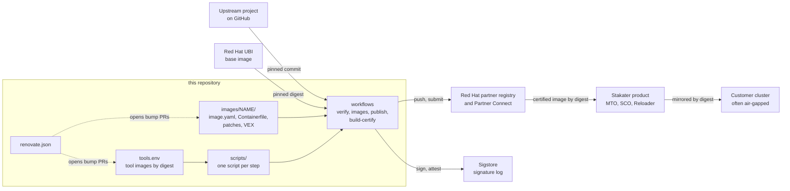
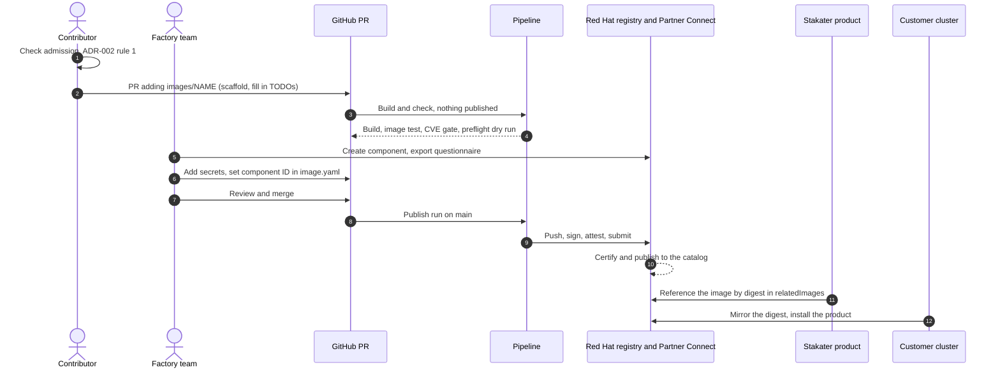
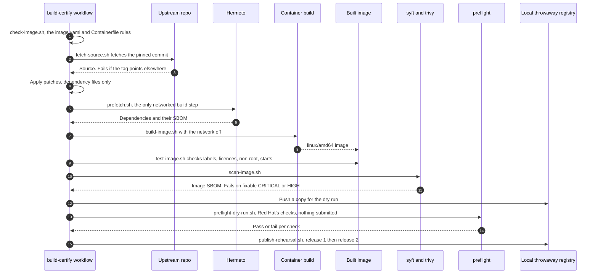
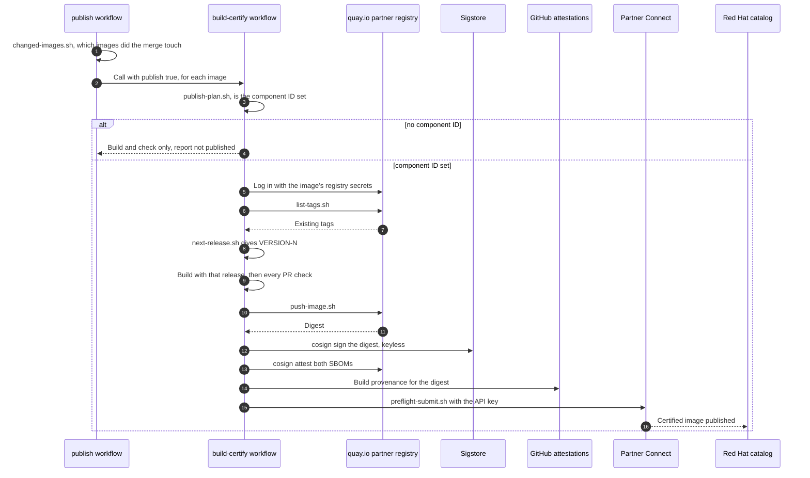
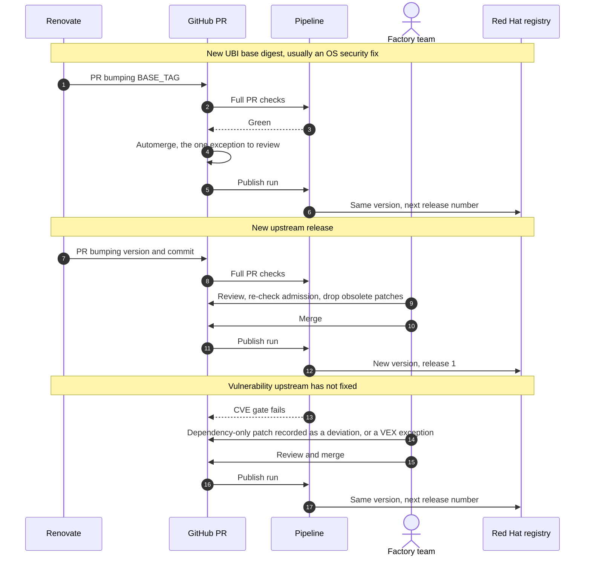

# certified-images

Stakater builds of upstream OSS, rebuilt from source on Red Hat UBI, certified for OpenShift, and shipped with SBOM, signatures and provenance. Used by Stakater products (MTO, SCO, Reloader Enterprise) so they install in **air-gapped** clusters and meet Red Hat's operand certification rule.

**We build on existing, proven implementations rather than inventing our own:** Iron Bank, OpenShift ART, Konflux/Hermeto, Chainguard, Crossplane packaging. See [docs/references.md](docs/references.md).

## Decisions
| ADR | Decision |
|---|---|
| [001](docs/adr/ADR-001-record-architecture-decisions.md) | How we record decisions: ADR format, revise or supersede, ⚠️ for unverified claims |
| [002](docs/adr/ADR-002-certified-ubi-rebuilds.md) | Umbrella: one factory, admission, allowed deviations, versions, patch SLA, governance |
| [003](docs/adr/ADR-003-hermetic-builds.md) | Commit-pinned source, Hermeto prefetch, `--network=none`, dependency-only patches |
| [004](docs/adr/ADR-004-base-images.md) | `BASE_REGISTRY/BASE_IMAGE/BASE_TAG`, digest-pinned UBI and toolchain, Renovate |
| [005](docs/adr/ADR-005-artifact-kinds-crossplane.md) | `kind: container / xpkg`; SCO Crossplane wrappers (Proposed) |
| [006](docs/adr/ADR-006-stakater-owned-upstreams.md) | Our own repos carry `Containerfile.ubi` + call the reusable workflow (Proposed) |
| [007](docs/adr/ADR-007-build-platform.md) | GitHub Actions; Konflux re-evaluated when a trigger fires |
| [008](docs/adr/ADR-008-supply-chain-evidence.md) | SBOMs, cosign, provenance, CVE gate + daily re-scan, OpenVEX exceptions |

## Status
**Pull requests build and check every image end to end. The publish path is written but has never run: no image is published or certified yet.**

| Stage | State |
|---|---|
| Checks on the repo itself (`make verify`) | Runs on every PR |
| Pinned source → Hermeto prefetch → offline build | Runs on every PR |
| Start-up test, SBOMs, CVE gate, preflight dry run | Runs on every PR |
| Release numbering and push | Rehearsed on every PR against a throwaway local registry |
| Login to Red Hat's registry, signing, attestations, `preflight --submit` | Written, **never run**. They need the secrets below and run for the first time on the first real publish |
| `CODEOWNERS`, branch protection, Renovate app | Not set up. They need a repository admin |

Images:

| Image | Upstream | Builds and passes checks | Published |
|---|---|---|---|
| `opencost` | opencost/opencost | Yes | Not yet. Component `6b07595f3ecfc52e21d75e12` is set; the first publish runs when this is on `main` and the secrets exist. Will be `registry.connect.redhat.com/stakater/opencost` |

How we work: [docs/method.md](docs/method.md).

## How it works

### The pieces



Each image is data in `images/NAME/`. The pipeline is the same for every image: workflows call scripts, and scripts run tools from pinned container images.

### Life of an image, end to end



### What a pull request runs

Nothing here needs a secret, and nothing leaves the runner except downloads.



### What a merge to main runs

The same job as above, with these steps added. It publishes only an image whose component ID is set.



### How an image stays current



⚠️ Renovate and the automerge have not run on this repository yet; the last diagram shows the design. A scheduled re-scan of already published images is planned and not built (ADR-002 rule 4).

## Layout
```
images/<name>/image.yaml        # kind, upstream repo+tag+commit, prefetch input, deviations, test command, Partner Connect ID
images/<name>/Containerfile     # hermetic build stage + parameterised, digest-pinned UBI runtime stage
images/<name>/patches/*.patch   # optional dependency-only patches, each listed under deviations (ADR-002 rule 2)
images/<name>/vex.openvex.json  # optional CVE exceptions (ADR-008)
scripts/                        # one script per pipeline step; the same scripts run locally and in CI
scripts/templates/              # what new-image.sh scaffolds from
.claude/skills/                 # add-image and fix-cve procedures for Claude Code
Makefile                        # make verify (checks on the repo), make image (build + check one image)
tools.env                       # every tool image, pinned by digest; the only place a tool is pinned
tests/                          # tests for the scripts and the checks
.github/workflows/build-certify.yaml  # the pipeline, as a reusable workflow (ADR-006)
.github/workflows/images.yaml         # calls it for every image on pull requests (read-only)
.github/workflows/publish.yaml        # calls it with publish=true on merges to main that touch an image
.github/workflows/verify.yaml         # make verify on pull requests
renovate.json                   # upstream tag+commit, UBI digest, toolchain digest, tool images
docs/                           # vision, method, roadmap, planning docs, ADRs, references
```

## Pipeline
On a pull request, per image:

1. **Fetch** the pinned commit. Fails if the tag points anywhere else.
2. **Patch**: apply `patches/*.patch`. Fails if a patch touches anything but dependency manifests and lockfiles.
3. **Prefetch** dependencies with Hermeto. This is the only step that uses the network.
4. **Build** with `--network=none`, for `linux/amd64`.
5. **Test** the image: labels match `image.yaml`, `/licenses` is populated, non-root, starts as an arbitrary UID.
6. **Scan**: syft SBOM of the image, Hermeto SBOM of the inputs, trivy gate on fixable CRITICAL and HIGH.
7. **Preflight dry run**: Red Hat's certification checks against a throwaway local registry. Nothing is submitted.

A separate job proves a build step cannot reach the network (`make test-hermetic`).

On a merge to `main` that touches an image (`publish.yaml`), the same job continues, for an image that has a Partner Connect component ID:

8. **Release number**: the next free `<upstream-version>-<release>` tag in the registry.
9. **Push** to `quay.io/redhat-isv-containers/<componentId>`.
10. **Sign** the digest with cosign (keyless), and **attest** both SBOMs and the build provenance.
11. **Submit** to Red Hat with `preflight --submit`. Partner Connect then publishes the image.

An image without a component ID is built and checked on `main` but not published; the run says so. To republish one image after a pipeline change, run the `publish` workflow by hand with the image name.

### Setup and secrets
The publish path needs one shared repository secret, plus two per image named from `redhat.secretSuffix` in `image.yaml`:

| Secret | How many | What |
|---|---|---|
| `RH_PYXIS_TOKEN` | One, for every image | Partner Connect API key for submitting certification results. The component is chosen by its ID, not by the key |
| `RH_REGISTRY_USER_<SUFFIX>` | One per image | The component's registry robot account. Red Hat gives each component its own repository and login |
| `RH_REGISTRY_PASSWORD_<SUFFIX>` | One per image | That account's registry key |

**[docs/setup.md](docs/setup.md) is the step-by-step guide**: where each value comes from, where it goes in GitHub, the order to do things in, and what to check after the first publish. In short: add the shared API key once; then per image, create the component, add its two registry secrets, and merge the PR that sets the component ID. That merge is the publish.

## Run it locally
You need docker or podman, `make`, `git` and `jq`. Every other tool runs from a container image pinned by digest.

```
make verify                  # checks on the repo: lint, image.yaml rules, script tests
make image IMAGE=opencost    # build, test, scan and dry-run certify one image
make test-hermetic           # prove a build step cannot reach the network
make publish-rehearsal IMAGE=opencost   # release numbering + push against a local registry (needs a built image)
```

On an Apple Silicon Mac, `make image` compiles under amd64 emulation and is very slow. CI takes about four minutes.

## Add an image
With Claude Code: `/add-image <name> <owner/repo> <tag>`. By hand, the same steps:

1. **Admission** (ADR-002 rule 1). All four must hold: no Red Hat image we may ship, a permissive licence, a maintained upstream, and a Stakater product that deploys it.
2. **Scaffold:** `scripts/new-image.sh <name> <owner/repo> <tag>`. It pins the tag's commit and writes `images/<name>/` from a template. Only Go upstreams have a template today.
3. **Fill in every `TODO`** in `image.yaml` and the Containerfile: licence, start-up test command, Go version, main package path, labels, licence files.
4. **`make verify`** until it passes. It rejects the scaffold as generated.
5. **Open a PR.** CI builds the image offline, tests it, scans it and runs Red Hat's checks as a dry run. If the CVE gate fails, see `.claude/skills/fix-cve/SKILL.md`.
6. **Human steps for certification:** create the Partner Connect component (Container image, **UBI**, **Red Hat Container Registry**), put its ID in `image.yaml`, submit the export questionnaire, add the repository secrets.
7. **A factory-team member merges.** The merge publishes and submits for certification.
8. **The consuming product pins the published digest** in its CSV `relatedImages`.

The full procedure, with what each CI failure means, is in `.claude/skills/add-image/SKILL.md`.

## Consuming
- **Operators:** CSV `relatedImages` + `RELATED_IMAGE_<NAME>`, by digest. Never upstream tags.
- **Crossplane (SCO):** install `stakater/<provider>` packages by digest. Air-gapped customers add an `ImageConfig` with `rewriteImage.prefix` to their mirror (Crossplane ≥ 1.20). This path is Proposed (ADR-005).

## Verify (customers)
⚠️ **Not run yet.** Nothing is signed until the first publish. These are the commands the first publish must be checked with, from a machine outside CI, against the public pull spec. They become documentation only after that.

```
REF=<registry>/<repository>@sha256:<digest>
ID='^https://github.com/stakater/certified-images/\.github/workflows/build-certify\.yaml@refs/heads/main$'
ISSUER=https://token.actions.githubusercontent.com

cosign verify "$REF" --certificate-identity-regexp "$ID" --certificate-oidc-issuer "$ISSUER"
cosign verify-attestation --type spdxjson "$REF" --certificate-identity-regexp "$ID" --certificate-oidc-issuer "$ISSUER"
gh attestation verify "oci://$REF" --repo stakater/certified-images \
  --signer-workflow stakater/certified-images/.github/workflows/build-certify.yaml
```

Open questions this run answers (ADR-008): whether the signature and attestations are reachable from Red Hat's public registry, and what provenance level we can claim (ADR-007).

## What has been settled by running it, and what is still unverified
Checked by running it (2026-11-25):
- Hermeto's `gomod` prefetch works with upstream's `go 1.27.3` directive and its local `replace` modules. It needs the source to be a git repository.
- Hermeto's dependency SBOM is `hermeto-output/bom.json`. It is CycloneDX by default; we ask for SPDX.
- preflight 1.23.0 uses `--certification-component-id`. A dry run needs a registry, so the pipeline starts a local one.
- `ubi9/ubi-minimal` ships a CA bundle. `ubi9/ubi-micro` does not, so OpenCost stays on `ubi-minimal` (ADR-004).
- All tool images and GitHub actions are pinned by digest or commit.

Still unverified:
- [ ] The whole outward-facing publish path: registry login, listing tags on Red Hat's registry (including an empty repository), cosign signing and attestations, provenance, `preflight --submit`. Written and linted, never run.
- [ ] trivy applies an OpenVEX file passed with `--vex` (marked experimental in trivy 0.76). No image has a VEX file yet, so this path has not run.
- [ ] Renovate keeps current: the UBI and toolchain digests, the upstream tag and commit (in `image.yaml` and the Containerfile together), and the tool images in `tools.env`. The config validates, but the Renovate app has not run on this repo.
- [ ] OpenCost's outbound TLS to cloud pricing APIs works in a cluster. The CA bundle is present; no request has been made.
