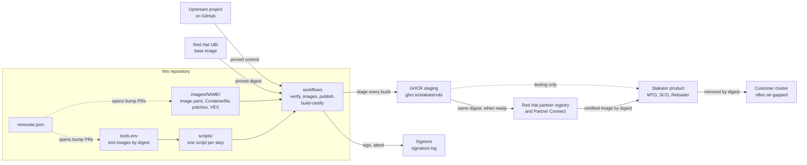
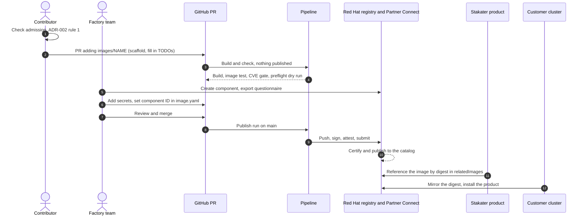
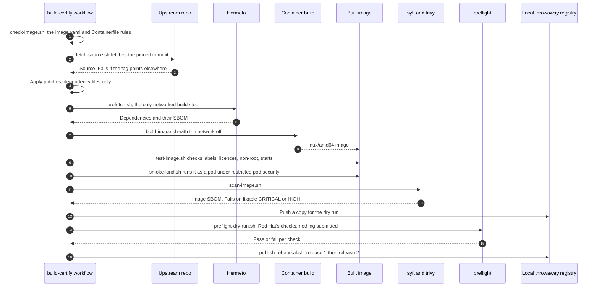
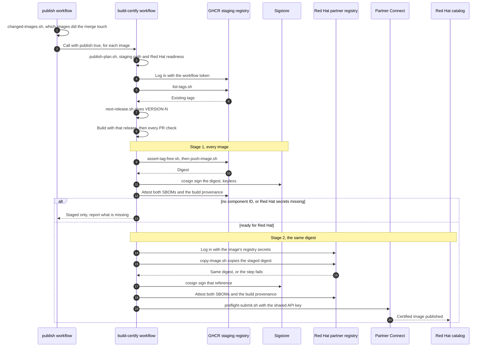
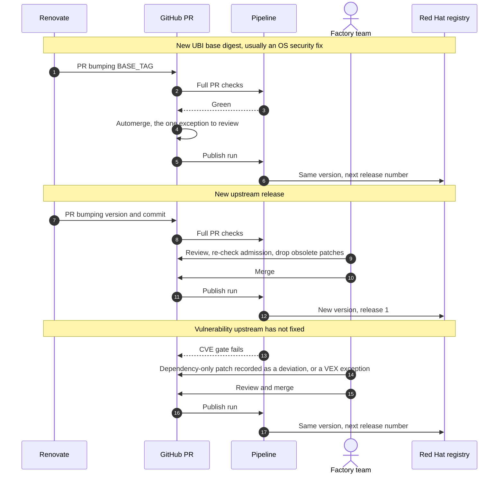

# certified-images

Stakater builds of upstream OSS, rebuilt from source on Red Hat UBI, certified for OpenShift, and shipped with SBOM, signatures and provenance. Used by Stakater products (MTO, SCO, Reloader Enterprise) so they install in **air-gapped** clusters and meet Red Hat's operand certification rule.

**We build on existing, proven implementations rather than inventing our own:** Iron Bank, OpenShift ART, Konflux/Hermeto, Chainguard, Crossplane packaging. See [docs/references.md](docs/references.md).

## Decisions
| ADR | Decision |
|---|---|
| [001](docs/adr/ADR-001-record-architecture-decisions.md) | How we record decisions: ADR format, revise or supersede, ⚠️ for unverified claims |
| [002](docs/adr/ADR-002-certified-ubi-rebuilds.md) | Umbrella: one factory, admission, allowed deviations, versions, patch SLA, governance |
| [003](docs/adr/ADR-003-hermetic-builds.md) | Commit-pinned source, Hermeto prefetch, `--network=none`, dependency-only patches |
| [004](docs/adr/ADR-004-base-images.md) | `BASE_REGISTRY/BASE_IMAGE/BASE_TAG`, digest-pinned UBI and toolchain, Renovate |
| [005](docs/adr/ADR-005-artifact-kinds-crossplane.md) | `kind: container / xpkg`; SCO Crossplane wrappers (Proposed) |
| [006](docs/adr/ADR-006-stakater-owned-upstreams.md) | Our own repos carry `Containerfile.ubi` + call the reusable workflow (Proposed) |
| [007](docs/adr/ADR-007-build-platform.md) | GitHub Actions; Konflux re-evaluated when a trigger fires |
| [009](docs/adr/ADR-009-image-labels.md) | Image labels: what built it, what is inside, what it is based on (Proposed) |
| [008](docs/adr/ADR-008-supply-chain-evidence.md) | SBOMs, cosign, provenance, CVE gate + daily re-scan, OpenVEX exceptions |

## Status
**Pull requests build and check every image end to end. Staging to GHCR works: the first image is staged, signed and attested. Nothing is published to Red Hat or certified yet.**

| Stage | State |
|---|---|
| Checks on the repo itself (`make verify`) | Runs on every PR |
| Pinned source → Hermeto prefetch → offline build | Runs on every PR |
| Start-up test, SBOMs, CVE gate, preflight dry run | Runs on every PR |
| **Smoke test as a pod** on a local cluster under restricted pod security | Runs on every PR. An approximation of OpenShift, **not OpenShift** |
| Smoke test on a real OpenShift cluster, gating promotion to Red Hat | Not built. Needs a cluster and credentials (story P.2b, level 2) |
| Release numbering, push, promotion by digest | Rehearsed on every PR against a throwaway local registry |
| **Staging to GHCR**: push, cosign signature, SBOM attestations, provenance | Works. First run 2026-11-26. Provenance verified from outside CI with `gh attestation verify`; the `cosign verify` commands have not been run yet |
| **Red Hat**: login, copy by digest, signing, `preflight --submit` | Written, **never run**. Needs the secrets in [docs/setup.md](docs/setup.md) |
| `CODEOWNERS`, branch protection, Renovate app | Not set up. They need a repository admin |

Images:

| Image | Upstream | Builds and passes checks | Staging (GHCR) | Red Hat (certified) |
|---|---|---|---|---|
| `opencost` | opencost/opencost | Yes | `ghcr.io/stakater/ubi/opencost`, public by declaration. Staged; latest `v1.121.5-2` | `registry.connect.redhat.com/stakater/opencost`, not published: component ID and secrets pending |
| `reloader` | stakater/Reloader, **v2 only** (pinned to a beta; v2 has no final release yet) | Yes | `ghcr.io/stakater/ubi/reloader`, public by declaration | Component `6af9776fa950dc6dbfa4d693` set; not published: secrets pending |

### Two registries

| Registry | What it holds | Who uses it |
|---|---|---|
| `ghcr.io/stakater/ubi/<name>` (staging) | Every build that passes the checks. Private by default; an image may declare `staging.visibility: public` in `image.yaml` (open-source rebuilds only) | Stakater teams, for testing |
| `registry.connect.redhat.com/stakater/<name>` (certified) | The same digest, after Red Hat certification | Anything shipped to a customer. A certified operator bundle must reference this one, never GHCR |

How we work: [docs/method.md](docs/method.md).

## How it works

### The pieces



Each image is data in `images/NAME/`. The pipeline is the same for every image: workflows call scripts, and scripts run tools from pinned container images.

### Life of an image, end to end



### What a pull request runs

Nothing here needs a secret, and nothing leaves the runner except downloads.



### What a merge to main runs

The same job as above, then two stages. Staging needs no secrets. The Red Hat stage runs only when the image has a component ID and its secrets exist.



### How an image stays current



⚠️ Renovate and the automerge have not run on this repository yet; the last diagram shows the design. A scheduled re-scan of already published images is planned and not built (ADR-002 rule 4).

## Layout
```
images/<name>/image.yaml        # kind, upstream repo+tag+commit, prefetch input, deviations, test command, Partner Connect ID
images/<name>/Containerfile     # hermetic build stage + parameterised, digest-pinned UBI runtime stage
images/<name>/patches/*.patch   # optional dependency-only patches, each listed under deviations (ADR-002 rule 2)
images/<name>/vex.openvex.json  # optional CVE exceptions (ADR-008)
scripts/                        # one script per pipeline step; the same scripts run locally and in CI
scripts/templates/              # what new-image.sh scaffolds from
.claude/skills/                 # add-image and fix-cve procedures for Claude Code
Makefile                        # make verify (checks on the repo), make image (build + check one image)
tools.env                       # every tool image, pinned by digest; the only place a tool is pinned
tests/                          # tests for the scripts and the checks
.github/workflows/build-certify.yaml  # the pipeline, as a reusable workflow (ADR-006)
.github/workflows/images.yaml         # calls it for every image on pull requests (read-only)
.github/workflows/publish.yaml        # calls it with publish=true on merges to main: stage to GHCR, then Red Hat when ready
.github/workflows/verify.yaml         # make verify on pull requests
.github/workflows/pyxis-probe.yaml    # manual: what Red Hat's API returns for a component, names only
renovate.json                   # upstream tag+commit, UBI digest, toolchain digest, tool images
docs/                           # vision, method, roadmap, planning docs, ADRs, references
```

## Pipeline
On a pull request, per image:

1. **Fetch** the pinned commit. Fails if the tag points anywhere else.
2. **Patch**: apply `patches/*.patch`. Fails if a patch touches anything but dependency manifests and lockfiles.
3. **Prefetch** dependencies with Hermeto. This is the only step that uses the network.
4. **Build** with `--network=none`, for `linux/amd64`.
5. **Test** the image: labels follow the label policy (ADR-009) and match `image.yaml`, `/licenses` is populated, non-root, starts as an arbitrary UID.
6. **Smoke test**: run it as a pod on a throwaway local cluster that enforces restricted pod security, with an arbitrary UID, a read-only root filesystem and no capabilities. It must become Ready, answer on its declared port and path, and not restart.
7. **Scan**: syft SBOM of the image, Hermeto SBOM of the inputs, trivy gate on fixable CRITICAL and HIGH.
8. **Preflight dry run**: Red Hat's certification checks against a throwaway local registry. Nothing is submitted.

Two separate jobs prove the checks can fail: a build step cannot reach the network (`make test-hermetic`), and the smoke test rejects an image that writes to its root filesystem or never serves (`make test-smoke`).

On a merge to `main` that touches an image (`publish.yaml`), the same job continues.

**Stage 1, every image: GHCR.** Needs no secrets.

9. **Release number**: the next free `<upstream-version>-<release>` tag in the staging repository. The image is built with that release.
10. **Push** to `ghcr.io/stakater/ubi/<name>`. A tag that already exists is refused.
11. **Sign** the digest with cosign (keyless), and **attest** both SBOMs and the build provenance.

**Stage 2, when the image is ready: Red Hat.** Runs only if the image has a Partner Connect component ID and its secrets exist. Otherwise the run says what is missing and stops after stage 1.

12. **Copy the staged digest** to `quay.io/redhat-isv-containers/<componentId>`, with the same tag. The copy fails unless the digest arrives unchanged.
13. **Sign and attest** that reference.
14. **Submit** to Red Hat with `preflight --submit`. Partner Connect then publishes the image.

To republish one image after a pipeline change, run the `publish` workflow by hand with the image name.

### Setup and secrets
Staging to GHCR needs no secrets. The Red Hat stage needs **two repository secrets in total**, however many images there are. No secret is named per image:

| Secret | What |
|---|---|
| `RH_PYXIS_TOKEN` | Partner Connect API key for submitting certification results. One key covers every component |
| `RH_REGISTRY_KEYS` | One JSON object holding each component's registry key, keyed by component ID. The username is derived from the component ID |

`RH_REGISTRY_KEYS` may turn out to be unnecessary: if Red Hat's API returns registry credentials given the API key, the pipeline can fetch them. The `pyxis-probe` workflow answers that once `RH_PYXIS_TOKEN` exists.

**[docs/setup.md](docs/setup.md) is the step-by-step guide**: where each value comes from, where it goes in GitHub, the order to do things in, and what to check after the first publish. In short: add the two secrets once; then per image, create the component, add its registry key as one entry in `RH_REGISTRY_KEYS`, and merge the PR that sets the component ID. That merge is the publish.

## Run it locally
You need docker or podman, `make`, `git` and `jq`. Every other tool runs from a container image pinned by digest.

```
make verify                  # checks on the repo: lint, image.yaml rules, script tests
make image IMAGE=opencost    # build, test, scan and dry-run certify one image
make test-hermetic           # prove a build step cannot reach the network
make smoke IMAGE=opencost    # run a built image as a pod on a local kind cluster (needs kind and kubectl)
make test-smoke              # prove the smoke test rejects broken images
make publish-rehearsal IMAGE=opencost   # release numbering + push against a local registry (needs a built image)
```

On an Apple Silicon Mac, `make image` compiles under amd64 emulation and is very slow. CI takes about four minutes.

## Add an image
With Claude Code: `/add-image <name> <owner/repo> <tag>`. By hand, the same steps:

1. **Admission** (ADR-002 rule 1). All four must hold: no Red Hat image we may ship, a permissive licence, a maintained upstream, and a Stakater product that deploys it.
2. **Scaffold:** `scripts/new-image.sh <name> <owner/repo> <tag>`. It pins the tag's commit and writes `images/<name>/` from a template. Only Go upstreams have a template today.
3. **Fill in every `TODO`** in `image.yaml` and the Containerfile: licence, tags, start-up test command, smoke test (port and health path), Go version, main package path, labels, licence files. If the image needs something to start (API access, a dependency), add test fixtures in `images/<name>/smoke/`.
4. **`make verify`** until it passes. It rejects the scaffold as generated.
5. **Open a PR.** CI builds the image offline, tests it, scans it and runs Red Hat's checks as a dry run. If the CVE gate fails, see `.claude/skills/fix-cve/SKILL.md`.
6. **Human steps for certification:** create the Partner Connect component (Container image, **UBI**, **Red Hat Container Registry**), put its ID in `image.yaml`, submit the export questionnaire, add the repository secrets.
7. **A factory-team member merges.** The merge stages the image to GHCR. If the component ID and secrets are in place it also publishes to Red Hat and submits for certification; steps 6 and 7 can happen in either order.
8. **The consuming product pins the published digest** in its CSV `relatedImages`.

The full procedure, with what each CI failure means, is in `.claude/skills/add-image/SKILL.md`.

## Consuming
- **Operators:** CSV `relatedImages` + `RELATED_IMAGE_<NAME>`, by digest. Never upstream tags.
- **Crossplane (SCO):** install `stakater/<provider>` packages by digest. Air-gapped customers add an `ImageConfig` with `rewriteImage.prefix` to their mirror (Crossplane ≥ 1.20). This path is Proposed (ADR-005).

## Verify (customers)
⚠️ **Not run yet.** Nothing is signed until the first publish. These are the commands the first publish must be checked with, from a machine outside CI: first against the staging reference, later against Red Hat's public pull spec. They become documentation only after that.

```
REF=<registry>/<repository>@sha256:<digest>   # staging: ghcr.io/stakater/ubi/<name>@sha256:...  (log in first if the image's staging is private)
ID='^https://github.com/stakater/certified-images/\.github/workflows/build-certify\.yaml@refs/heads/main$'
ISSUER=https://token.actions.githubusercontent.com

cosign verify "$REF" --certificate-identity-regexp "$ID" --certificate-oidc-issuer "$ISSUER"
cosign verify-attestation --type spdxjson "$REF" --certificate-identity-regexp "$ID" --certificate-oidc-issuer "$ISSUER"
gh attestation verify "oci://$REF" --repo stakater/certified-images \
  --signer-workflow stakater/certified-images/.github/workflows/build-certify.yaml
```

Open questions this run answers (ADR-008): whether the signature and attestations are reachable from Red Hat's public registry, and what provenance level we can claim (ADR-007).

## What has been settled by running it, and what is still unverified
Checked by running it (2026-11-25):
- Hermeto's `gomod` prefetch works with upstream's `go 1.27.3` directive and its local `replace` modules. It needs the source to be a git repository.
- Hermeto's dependency SBOM is `hermeto-output/bom.json`. It is CycloneDX by default; we ask for SPDX.
- preflight 1.23.0 uses `--certification-component-id`. A dry run needs a registry, so the pipeline starts a local one.
- `ubi9/ubi-minimal` ships a CA bundle. `ubi9/ubi-micro` does not, so OpenCost stays on `ubi-minimal` (ADR-004).
- All tool images and GitHub actions are pinned by digest or commit.
- **What the smoke test found about OpenCost** (2026-11-26). It runs as an arbitrary UID with a read-only root filesystem and no capabilities. Inside a cluster it exits at start-up unless it has read access to the Kubernetes API and a Prometheus that already reports a running scrape job. It tries to create `/var/configs` and falls back to memory when it cannot. A product deploying it needs RBAC, a reachable Prometheus, and a writable volume at `/var/configs` if that state should persist.
- Staging to GHCR (2026-11-26): the workflow token can create `ghcr.io/stakater/ubi/<name>`; push, keyless signing, SBOM attestations and provenance all ran. `gh attestation verify` from outside CI confirms the provenance was signed by `build-certify.yaml` on `main`.
- **A package created by this public repository is public by default.** Each image declares its staging visibility (private unless stated), and the pipeline fails if a package is more open than declared.

Still unverified:
- [ ] **That an image works on OpenShift itself.** The smoke test runs on a local Kubernetes cluster with restricted pod security, which approximates OpenShift's `restricted-v2`. It does not exercise OpenShift's SCC admission, its UID ranges, SELinux or FIPS mode. Level 2 of story P.2b runs the same test on a real OpenShift cluster.
- [ ] That an image does its job for a product. The smoke test shows OpenCost starts and serves `/healthz`; it does not check any cost data. That is story P.3.
- [ ] The Red Hat stage: registry login, copy by digest, `preflight --submit`. Written and linted, never run.
- [ ] `cosign verify` and `cosign verify-attestation` against a staged image from outside CI. Signing ran in CI without error; only `gh attestation verify` has been run from outside.
- [ ] trivy applies an OpenVEX file passed with `--vex` (marked experimental in trivy 0.76). No image has a VEX file yet, so this path has not run.
- [ ] Renovate keeps current: the UBI and toolchain digests, the upstream tag and commit (in `image.yaml` and the Containerfile together), and the tool images in `tools.env`. The config validates, but the Renovate app has not run on this repo.
- [ ] OpenCost's outbound TLS to cloud pricing APIs works in a cluster. The CA bundle is present; no request has been made.
