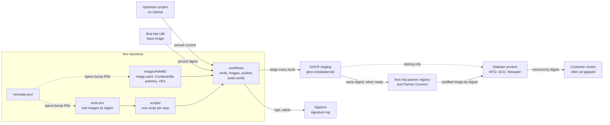
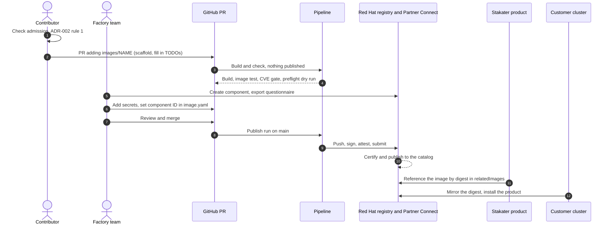
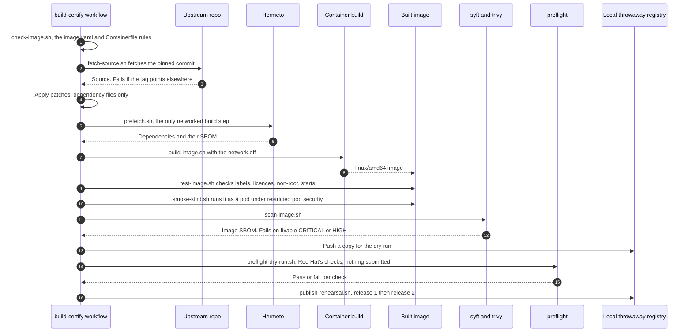
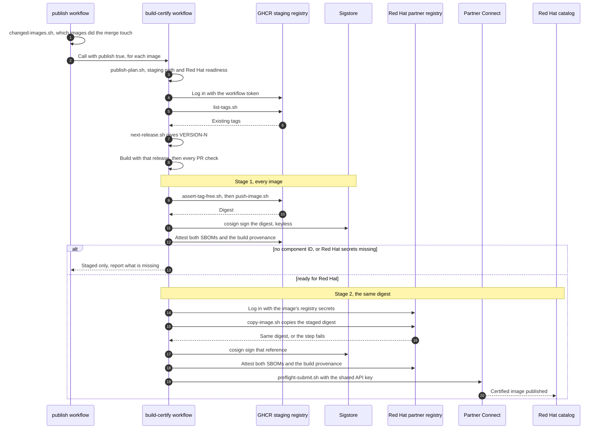
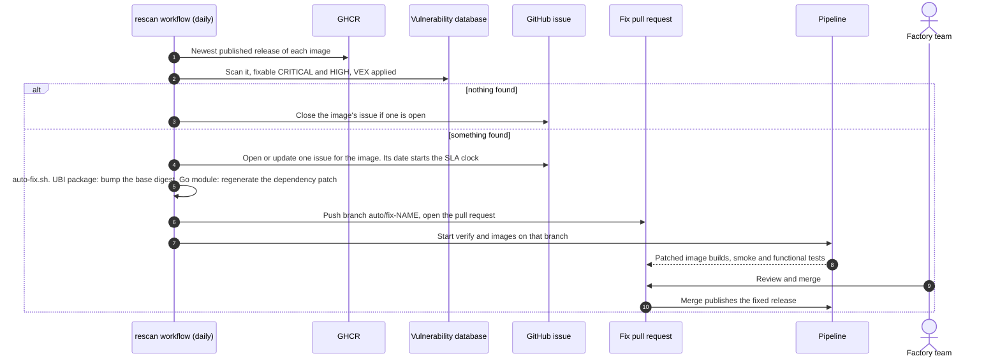
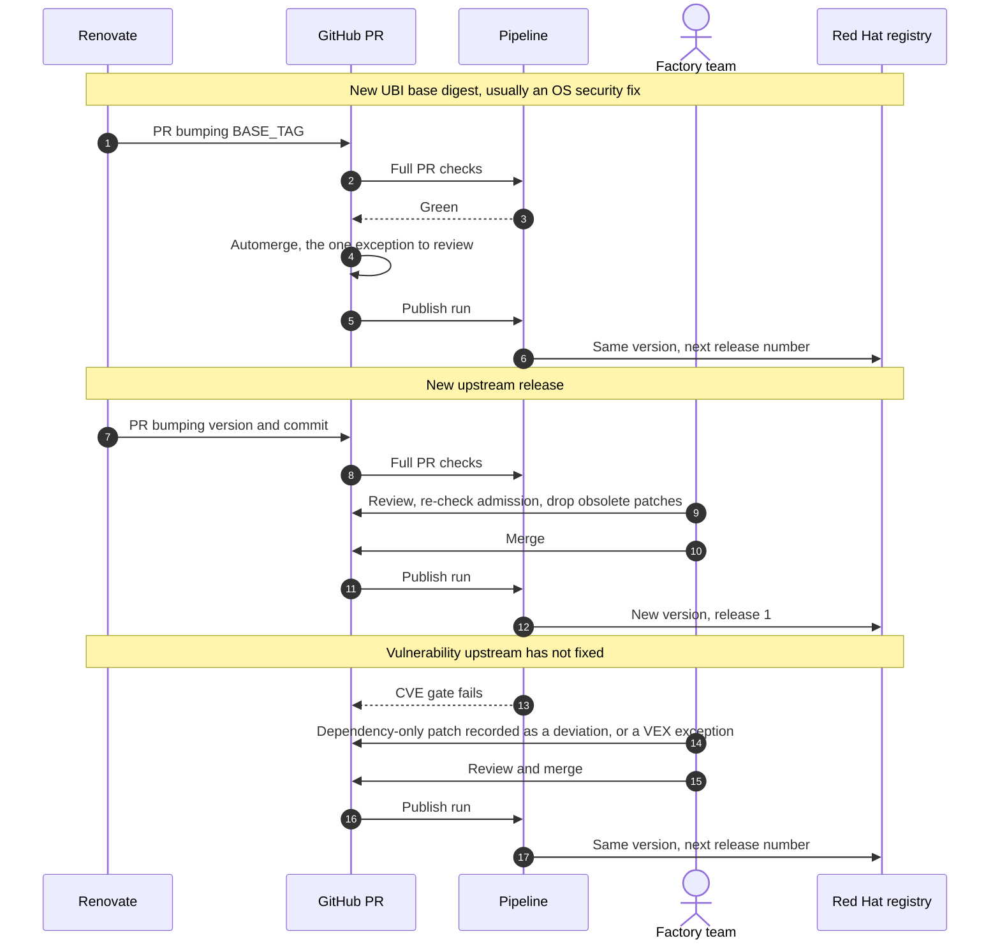

# certified-images

Stakater builds of upstream OSS, rebuilt from source on Red Hat UBI, certified for OpenShift, and shipped with SBOM, signatures and provenance. Used by Stakater products (MTO, SCO, Reloader Enterprise) so they install in **air-gapped** clusters and meet Red Hat's operand certification rule.

**We build on existing, proven implementations rather than inventing our own:** Iron Bank, OpenShift ART, Konflux/Hermeto, Chainguard, Crossplane packaging. See [docs/references.md](docs/references.md).

## Decisions
| ADR | Decision |
|---|---|
| [001](docs/adr/ADR-001-record-architecture-decisions.md) | How we record decisions: ADR format, revise or supersede, ⚠️ for unverified claims |
| [002](docs/adr/ADR-002-certified-ubi-rebuilds.md) | Umbrella: one factory, admission, allowed deviations, versions, patch SLA, governance |
| [003](docs/adr/ADR-003-hermetic-builds.md) | Commit-pinned source, Hermeto prefetch, `--network=none`, dependency-only patches |
| [004](docs/adr/ADR-004-base-images.md) | `BASE_REGISTRY/BASE_IMAGE/BASE_TAG`, digest-pinned UBI and toolchain, Renovate |
| [005](docs/adr/ADR-005-artifact-kinds-crossplane.md) | `kind: container / xpkg`; SCO Crossplane wrappers (Proposed) |
| [006](docs/adr/ADR-006-stakater-owned-upstreams.md) | Our own repos carry `Containerfile.ubi` + call the reusable workflow (Proposed) |
| [007](docs/adr/ADR-007-build-platform.md) | GitHub Actions; Konflux re-evaluated when a trigger fires |
| [009](docs/adr/ADR-009-image-labels.md) | Image labels: what built it, what is inside, what it is based on (Proposed) |
| [008](docs/adr/ADR-008-supply-chain-evidence.md) | SBOMs, cosign, provenance, CVE gate + daily re-scan, OpenVEX exceptions |

## Status
**Pull requests build and check every image end to end. Staging to GHCR works: the first image is staged, signed and attested. Nothing is published to Red Hat or certified yet.**

| Stage | State |
|---|---|
| Checks on the repo itself (`make verify`) | Runs on every PR |
| Pinned source → Hermeto prefetch → offline build | Runs on every PR |
| Start-up test, SBOMs, CVE gate, preflight dry run | Runs on every PR |
| **Smoke test as a pod** on a local cluster under restricted pod security | Runs on every PR. An approximation of OpenShift, **not OpenShift** |
| Smoke test on a real OpenShift cluster, gating promotion to Red Hat | Not built. Needs a cluster and credentials (story P.2b, level 2) |
| Release numbering, push, promotion by digest | Rehearsed on every PR against a throwaway local registry |
| **Staging to GHCR**: push, cosign signature, SBOM attestations, provenance | Works. First run 2026-11-26. Provenance verified from outside CI with `gh attestation verify`; the `cosign verify` commands have not been run yet |
| **Red Hat, when Red Hat lists and we host** (setup B): submit the GHCR image | Submission and certification work (first on 2026-11-27). ❌ The certified image is not yet pullable from Red Hat's address, so the route is **not proven end to end** |
| **Red Hat, when Red Hat hosts** (setup A): login, copy by digest, signing, submit | Works. First run 2026-11-27 with OpenCost: logged in, copied the same digest, signed, submitted. Publication waits on Red Hat's export approval, so a pull from Red Hat's address is **not yet seen** |
| **Daily re-scan** of published images, one issue per image, automatic fix pull request | Built. The re-scan was run by hand against the three published images (no findings). The scheduled run, the issue and the automatic pull request have **not run yet** |
| `CODEOWNERS`, branch protection, Renovate app | Not set up. They need a repository admin |

**Catalogue site:** https://stakater.github.io/certified-images/ lists every public image with its releases, evidence and Red Hat status, generated from this repository (story S.1). Live since 2026-11-28; each image has a page with its container details, releases, signed SBOM, verify commands and a full vulnerability scan.

Images:

| Image | Upstream | Builds and passes checks | Staging (GHCR) | Red Hat (certified) |
|---|---|---|---|---|
| `opencost` | opencost/opencost | Yes | `ghcr.io/stakater/ubi/opencost`, public by declaration | Submitted 2026-11-27: `v1.121.5-6` is on Red Hat's registry, signed, certification in progress. Not published until export approval; then `registry.connect.redhat.com/stakater/opencost` |
| `reloader-operator` | stakater/Reloader, **v2 only** (pinned to a beta; v2 has no final release yet) | Yes | `ghcr.io/stakater/ubi/reloader-operator`, public by declaration. (Two earlier releases sit under the old name, `ubi/reloader`) | **Certified and listed** in Red Hat's catalog: `registry.connect.redhat.com/stakater/reloader-operator`, tag `v2.0.0-beta.3-2`, health grade A (2026-11-27). ❌ **Not pullable from that address yet**: Red Hat's registry answers "unauthorized" with a valid login ([details](docs/red-hat-distribution.md)) |
| `dex` | dexidp/dex | Yes | `ghcr.io/stakater/ubi/dex`, public by declaration | No component yet |
| `kube-state-metrics` | kubernetes/kube-state-metrics | Yes | `ghcr.io/stakater/ubi/kube-state-metrics`, public by declaration | No component yet |
| `prometheus` | prometheus/prometheus (server with its web UI built from source, and promtool) | Yes, on its pull request (2026-11-28); not merged | `ghcr.io/stakater/ubi/prometheus`, public by declaration; nothing published yet | No component yet |
| `crossplane` | crossplane/crossplane (the core and its RBAC manager, not a provider) | Yes | `ghcr.io/stakater/ubi/crossplane`, public by declaration | No component yet |
| `etcd-druid` | gardener/etcd-druid (the operator only; the etcd pods it creates use three other images, not built here) | Yes | `ghcr.io/stakater/ubi/etcd-druid`, public by declaration | No component yet |
| `etcd-wrapper` | gardener/etcd-wrapper (the etcd container of etcd-druid's pods) | Yes | `ghcr.io/stakater/ubi/etcd-wrapper`, public by declaration | No component yet |
| `etcd-backup-restore` | gardener/etcd-backup-restore (`etcdbrctl`, the sidecar of etcd-druid's pods) | Yes | `ghcr.io/stakater/ubi/etcd-backup-restore`, public by declaration | No component yet |
| `kcp` | kcp-dev/kcp (server, front proxy, virtual workspaces, cache server; no kubectl) | Yes | `ghcr.io/stakater/ubi/kcp`, public by declaration | No component yet |

For how an image reaches a customer through Red Hat, the three ways a component can be set up, and what is proven about each, see [docs/red-hat-distribution.md](docs/red-hat-distribution.md).

### Where images live

| Address | What it is |
|---|---|
| `ghcr.io/stakater/ubi/<name>` | Our registry. Every build that passes the checks, signed, with SBOMs. Private by default; an image may declare itself public (open-source rebuilds only) |
| `registry.connect.redhat.com/stakater/<name>` | Red Hat's address for the certified image. This is what customers and certified operator bundles reference |

For most images Red Hat serves that address **from our GHCR**: we host, Red Hat lists. Being on GHCR does not make an image certified; being submitted and accepted does. A tag that Red Hat lists must never be deleted from GHCR.

How we work: [docs/method.md](docs/method.md).

## How it works

### The pieces



Each image is data in `images/NAME/`. The pipeline is the same for every image: workflows call scripts, and scripts run tools from pinned container images.

### Life of an image, end to end



### What a pull request runs

Nothing here needs a secret, and nothing leaves the runner except downloads.



### What a merge to main runs

The same job as above, then two stages. Staging needs no secrets. The Red Hat stage runs only when the image has a component ID and its secrets exist.



### Staying on top of vulnerabilities

Every day `rescan.yaml` looks at what is actually published, not at what was true when it was built:



Nobody learns of a vulnerability before it is disclosed. What this buys is the time from disclosure to a tested fix waiting for review: hours, not whenever someone next rebuilds. It does not merge. Go standard-library findings are reported but not fixed automatically yet.

### How an image stays current



⚠️ The hosted Renovate app and the automerge have not run on this repository yet; the last diagram shows the design. The config itself was run locally in report-only mode on 2026-11-28 and detects every pin (docs/setup.md, step 2).

## Layout
```
images/<name>/image.yaml        # kind, upstream repo+tag+commit, prefetch input, deviations, test command, Partner Connect ID
images/<name>/Containerfile     # hermetic build stage + parameterised, digest-pinned UBI runtime stage
images/<name>/patches/*.patch   # optional dependency-only patches, each listed under deviations (ADR-002 rule 2)
images/<name>/vex.openvex.json  # optional CVE exceptions (ADR-008)
images/<name>/smoke/*.yaml      # optional fixtures the smoke test deploys first
images/<name>/smoke/deploy.sh   # optional: the image deploys itself for the smoke test, when one bare pod is not enough
images/<name>/functional/test.sh # optional test of what the image does, run after the smoke test
stacks/<name>/                  # images that only work together: the list, and a test that runs them with each other
site/                           # the public catalogue site's pages; scripts/site-data.sh generates its data
scripts/                        # one script per pipeline step; the same scripts run locally and in CI
scripts/templates/              # what new-image.sh scaffolds from
.claude/skills/                 # add-image and fix-cve procedures for Claude Code
Makefile                        # make verify (checks on the repo), make image (build + check one image)
tools.env                       # every tool image, pinned by digest; the only place a tool is pinned
tests/                          # tests for the scripts and the checks
.github/workflows/build-certify.yaml  # the pipeline, as a reusable workflow (ADR-006)
.github/workflows/images.yaml         # calls it for every image on pull requests (read-only)
.github/workflows/publish.yaml        # calls it with publish=true on merges to main: stage to GHCR, then Red Hat when ready
.github/workflows/verify.yaml         # make verify on pull requests
.github/workflows/rescan.yaml         # daily: scan published images, keep an issue per image, open a fix pull request
.github/workflows/pyxis-probe.yaml    # manual: what Red Hat's API returns for a component, names only
.github/workflows/rh-submit.yaml      # manual, OUTWARD-FACING: submit a tag already on GHCR to Red Hat (setup B)
renovate.json                   # upstream tag+commit, UBI digest, toolchain digest, tool images
docs/                           # vision, method, roadmap, planning docs, ADRs, references
```

## Pipeline
On a pull request, per image:

1. **Fetch** the pinned commit. Fails if the tag points anywhere else.
2. **Patch**: apply `patches/*.patch`. Fails if a patch touches anything but dependency manifests and lockfiles.
3. **Prefetch** dependencies with Hermeto. This is the only step that uses the network.
4. **Build** with `--network=none`, for `linux/amd64`.
5. **Test** the image: labels follow the label policy (ADR-009) and match `image.yaml`, `/licenses` is populated, non-root, starts as an arbitrary UID.
6. **Smoke test**: run it as a pod on a throwaway local cluster that enforces restricted pod security, with an arbitrary UID, a read-only root filesystem and no capabilities. It must become Ready, answer on its declared port and path, and not restart. If the image ships a **functional test** (`images/<name>/functional/test.sh`), that runs next, against the running image: it tests what the image does, not just that it starts.
7. **Scan**: syft SBOM of the image, Hermeto SBOM of the inputs, trivy gate on fixable CRITICAL and HIGH.
8. **Preflight dry run**: Red Hat's certification checks against a throwaway local registry. Nothing is submitted.

Two separate jobs prove the checks can fail: a build step cannot reach the network (`make test-hermetic`), and the smoke test rejects an image that writes to its root filesystem or never serves (`make test-smoke`).

On a merge to `main` that touches an image (`publish.yaml`), the same job continues.

**Stage 1, every image: GHCR.** Needs no secrets.

9. **Release number**: the next free `<upstream-version>-<release>` tag in the staging repository. The image is built with that release.
10. **Push** to `ghcr.io/stakater/ubi/<name>`. A tag that already exists is refused.
11. **Sign** the digest with cosign (keyless), and **attest** both SBOMs and the build provenance.

**Stage 2, when the image has a Partner Connect component ID: Red Hat.** The pipeline asks Red Hat how the component is distributed and follows that.

*Red Hat lists it, we host it (setup B, the default):*

12. **Submit** the GHCR image to Red Hat with `preflight --submit`. Red Hat certifies it and lists it under `registry.connect.redhat.com`. Needs only `RH_PYXIS_TOKEN`: no login, no push, no copy.

*Red Hat hosts it (setup A):*

12. **Copy the same digest** to `quay.io/redhat-isv-containers/<componentId>`, using that component's registry key. The copy fails unless the digest arrives unchanged.
13. **Sign and attest** that reference, then **submit**.

If `RH_PYXIS_TOKEN` is missing, or a setup A component has no registry key, the run says what is missing and stops after stage 1.

To republish one image after a pipeline change, run the `publish` workflow by hand with the image name.

### Setup and secrets
Pushing to GHCR needs no secrets. Red Hat needs **one repository secret**, and a second only for Red Hat-hosted components. No secret is named per image:

| Secret | Needed for | What |
|---|---|---|
| `RH_PYXIS_TOKEN` | Every component | Partner Connect API key. Submits certification results and reads how a component is distributed |
| `RH_REGISTRY_KEYS` | Only components Red Hat hosts (setup A) | One JSON object holding each such component's registry key, keyed by component ID |

New components are created Red Hat-hosted, which is the route that has been seen to deliver. The other route, where Red Hat lists an image that stays on GHCR, needs no registry key but is not proven: see [docs/red-hat-distribution.md](docs/red-hat-distribution.md).

**[docs/setup.md](docs/setup.md) is the step-by-step guide**: where each value comes from, where it goes in GitHub, the order to do things in, and what to check after the first publish. In short: add `RH_PYXIS_TOKEN` once; then per image, create the component and merge the PR that sets its ID. Only a Red Hat-hosted component also needs an entry in `RH_REGISTRY_KEYS`. That merge is the publish.

## Run it locally
You need docker or podman, `make`, `git` and `jq`. Every other tool runs from a container image pinned by digest.

```
make verify                  # checks on the repo: lint, image.yaml rules, script tests
make image IMAGE=opencost    # build, test, scan and dry-run certify one image
make test-hermetic           # prove a build step cannot reach the network
make smoke IMAGE=opencost    # run a built image as a pod on a local kind cluster (needs kind and kubectl)
make test-smoke              # prove the smoke test rejects broken images
# make smoke also runs the image's functional test, if it has one
make publish-rehearsal IMAGE=opencost   # release numbering + push against a local registry (needs a built image)
```

On an Apple Silicon Mac, `make image` compiles under amd64 emulation and is very slow. CI takes about four minutes.

## Add an image
With Claude Code: `/add-image <name> <owner/repo> <tag>`. By hand, the same steps:

1. **Admission** (ADR-002 rule 1). All four must hold: no Red Hat image we may ship, a permissive licence, a maintained upstream, and a Stakater product that deploys it.
2. **Scaffold:** `scripts/new-image.sh <name> <owner/repo> <tag>`. It pins the tag's commit and writes `images/<name>/` from a template. Only Go upstreams have a template today.
3. **Fill in every `TODO`** in `image.yaml` and the Containerfile: licence, tags, start-up test command, smoke test (port and health path), Go version, main package path, labels, licence files. If the image needs something to start (API access, a dependency), add test fixtures in `images/<name>/smoke/`. To test what the image does, add `images/<name>/functional/test.sh`.
4. **`make verify`** until it passes. It rejects the scaffold as generated.
5. **Open a PR.** CI builds the image offline, tests it, scans it and runs Red Hat's checks as a dry run. If the CVE gate fails, see `.claude/skills/fix-cve/SKILL.md`.
6. **Human steps for certification:** create the Partner Connect component (Container image, **UBI**, **Red Hat Container Registry**), put its ID in `image.yaml`, submit the export questionnaire, add the repository secrets.
7. **A factory-team member merges.** The merge stages the image to GHCR. If the component ID and secrets are in place it also publishes to Red Hat and submits for certification; steps 6 and 7 can happen in either order.
8. **The consuming product pins the published digest** in its CSV `relatedImages`.

The full procedure, with what each CI failure means, is in `.claude/skills/add-image/SKILL.md`.

## Consuming
- **Operators:** CSV `relatedImages` + `RELATED_IMAGE_<NAME>`, by digest. Never upstream tags.
- **Crossplane (SCO):** install `stakater/<provider>` packages by digest. Air-gapped customers add an `ImageConfig` with `rewriteImage.prefix` to their mirror (Crossplane ≥ 1.20). This path is Proposed (ADR-005).

## Verify (customers)
Run from outside CI on 2026-11-28 for the seven images published that week: signatures, SBOM attestations and provenance all verify, and an unsigned release correctly fails. **cosign 3 or newer is needed.** The pipeline signs with cosign 3, and cosign 2 reports "no signatures found" for a correctly signed image. The catalogue site shows these commands filled in for each image.

```
REF=<registry>/<repository>@sha256:<digest>   # staging: ghcr.io/stakater/ubi/<name>@sha256:...  (log in first if the image's staging is private)
ID='^https://github.com/stakater/certified-images/\.github/workflows/build-certify\.yaml@refs/heads/main$'
ISSUER=https://token.actions.githubusercontent.com

cosign verify "$REF" --certificate-identity-regexp "$ID" --certificate-oidc-issuer "$ISSUER"
cosign verify-attestation --type spdxjson "$REF" --certificate-identity-regexp "$ID" --certificate-oidc-issuer "$ISSUER"
gh attestation verify "oci://$REF" --repo stakater/certified-images \
  --signer-workflow stakater/certified-images/.github/workflows/build-certify.yaml
```

Open questions this run answers (ADR-008): whether the signature and attestations are reachable from Red Hat's public registry, and what provenance level we can claim (ADR-007).

## What has been settled by running it, and what is still unverified
Checked by running it (2026-11-25):
- Hermeto's `gomod` prefetch works with upstream's `go 1.27.3` directive and its local `replace` modules. It needs the source to be a git repository.
- Hermeto's dependency SBOM is `hermeto-output/bom.json`. It is CycloneDX by default; we ask for SPDX.
- preflight 1.23.0 uses `--certification-component-id`. A dry run needs a registry, so the pipeline starts a local one.
- `ubi9/ubi-minimal` ships a CA bundle. `ubi9/ubi-micro` does not, so OpenCost stays on `ubi-minimal` (ADR-004).
- All tool images and GitHub actions are pinned by digest or commit.
- **Red Hat images our products use instead of a build from this factory** (ADR-002 rule 1). PostgreSQL for MTO is `registry.access.redhat.com/hi/postgresql`, by digest. Our build gate's scanner cannot read it, so it is scanned with grype each time the catalogue site is generated; on 2026-11-28 it had no fixable critical or high finding. It runs with a read-only root filesystem as its own user (UID 999); as an arbitrary UID it also needs a passwd entry for that UID. Details and the trial of 2026-11-28 are in [docs/roadmap.md](docs/roadmap.md).
- **What the smoke test found about OpenCost** (2026-11-26). It runs as an arbitrary UID with a read-only root filesystem and no capabilities. Inside a cluster it exits at start-up unless it has read access to the Kubernetes API and a Prometheus that already reports a running scrape job. It tries to create `/var/configs` and falls back to memory when it cannot. A product deploying it needs RBAC, a reachable Prometheus, and a writable volume at `/var/configs` if that state should persist.
- Staging to GHCR (2026-11-26): the workflow token can create `ghcr.io/stakater/ubi/<name>`; push, keyless signing, SBOM attestations and provenance all ran. `gh attestation verify` from outside CI confirms the provenance was signed by `build-certify.yaml` on `main`.
- **A package created by this public repository is public by default.** Each image declares its staging visibility (private unless stated), and the pipeline fails if a package is more open than declared.

Still unverified:
- [ ] **That an image works on OpenShift itself.** The smoke test runs on a local Kubernetes cluster with restricted pod security, which approximates OpenShift's `restricted-v2`. It does not exercise OpenShift's SCC admission, its UID ranges, SELinux or FIPS mode. Level 2 of story P.2b runs the same test on a real OpenShift cluster.
- [ ] That OpenCost does its job. It has no functional test: producing cost data needs real metrics, which is story P.3. Reloader has one (a ConfigMap change rolls the workload, an unrelated one does not), so far run only on a local cluster, not on OpenShift.
- [ ] That a Red Hat-hosted image pulls from `registry.connect.redhat.com` once published. The pipeline's part ran on 2026-11-27 (login, copy by digest, signing, submission); publication waits on export approval.
- [x] `cosign verify` and `cosign verify-attestation` against published images from outside CI (2026-11-28, cosign 3.1.5): pass for seven images; cosign 2.6.1 cannot see the signatures.
- [ ] trivy applies an OpenVEX file passed with `--vex` (marked experimental in trivy 0.76). No image has a VEX file yet, so this path has not run.
- [ ] Renovate keeps current: the UBI and toolchain digests, the upstream tag and commit (in `image.yaml` and the Containerfile together), and the tool images in `tools.env`. The config validates, but the Renovate app has not run on this repo.
- [ ] OpenCost's outbound TLS to cloud pricing APIs works in a cluster. The CA bundle is present; no request has been made.
