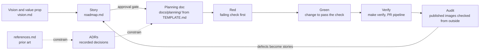

# The method — story → plan → red → green → verify → audit

How this repo is built. It is the method codified in `kube-ward/docs/method.md`,
adapted to a build-and-release repo. That method borrowed two things from BMAD
(v6): the **context-capsule planning doc** and the **explicit story approval
gate**. It kept its own ADRs, a single agent with human gates instead of
persona handoffs, and an outer audit loop. This repo's ADR rules are in
ADR-001, which allows revising an ADR in place with the old version archived;
kube-ward only supersedes.

Every practice should be enforced somewhere concrete. In this repo most of the
enforcement does not exist yet, and the table below says so instead of
pretending.

## The loop

There are two loops:

- The **inner build loop** (story → plan → red → green → verify) ships one story
  end to end.
- The **outer evidence loop** (audit → fix stories → re-audit) checks whether
  what we published is what we claim. Green CI at build time says nothing about
  an image three weeks later, when new CVEs have landed against it.

## The practices, and where each is enforced

| Practice | What it looks like here | Enforced by |
|---|---|---|
| Spec first | vision → story → planning doc, in that order, before any change | workflow rule in `CLAUDE.md`; planning doc committed before the implementation |
| Recorded decisions | `docs/adr/`: history is never rewritten; an ADR is revised with the old version archived, or superseded | ADR-001; review |
| Prior art first | every ADR names the reference it copies, or names the gap as a risk | `docs/references.md`; ADR-002 rule 7; review |
| Story-driven delivery | house story format, a **Done:** line, the lifecycle below, one story at a time | roadmap convention; PRs cite the story |
| Test first | red → green on the factory's checks: lint, `image.yaml` rules, script tests | `make verify`, run by the edit hook (`.claude/settings.json`) and on every PR (`verify.yaml`). Image-level tests are **not yet enforced** (story P.1) |
| Hermetic pipeline as the end-to-end test | a PR runs prefetch → offline build → SBOM → CVE gate → preflight | **not yet enforced.** The workflow does not exist (story P.1) |
| Outer audit | published images are re-checked from outside on a schedule (below) | **not yet enforced.** Story to be written after the first publish |
| Context persistence | `CLAUDE.md` invariants + context-capsule planning docs | `docs/planning/TEMPLATE.md` |

## Story lifecycle

**📝 Draft** — written down so it is not lost; explicitly not agreed. It may be
re-scoped or killed. → **👍 Approved** — a human said build it. → **🔨 In
progress** — one at a time, end to end. → **✅ Done** — the Done line is met,
the checks are green, and the planning doc is linked from the story.

The gate exists because comply-by-default is the failure mode. An unapproved
story must never start.

Story format: *As a `<role>`, I want `<capability>`, so that `<value>`.* Each
story has a **Done:** line that a third party could check.

## The planning doc is a context capsule

`docs/planning/TEMPLATE.md` is the contract. A planning doc must carry enough
context that a cold session, with no memory and no conversation history, can
execute the story without re-scouting the repo: the story and its why, the
governing ADRs and invariants, the exact files, the checks to write first, and
what is out of scope. If it needs its author present to be actionable, it is
not finished.

## The outer audit loop, for an image factory

The claims this repo makes are checkable from outside, so the audit checks them
from outside, per published image:

1. **Signature and attestations verify** with the commands in the README, from a
   machine that is not the CI runner.
2. **Red Hat's view:** certification status and the catalog health grade.
3. **Patch SLA** (ADR-002 rule 4): for each fixable CRITICAL or HIGH CVE, the
   time from fix available to fixed image published.
4. **Exceptions:** every OpenVEX statement is unexpired and still true.
5. **Consumers:** each product pins the current digest, not a stale one.

Misses are grouped into defect families and become stories. A fix declares its
**signature**: the observable result the next audit should see. A fix that
cannot state one says so.

## Invariants of the method

1. **No change without a red check that demanded it.** Where no check can exist
   yet, the story says so and names the manual verification.
2. **No implementation without a committed plan; no plan without a story; no
   story built without approval.**
3. **Honest over complete.** "Not built", "couldn't verify" and "not assessed"
   beat a confident guess, in docs, checklists and status reports alike.
4. **Docs are the source of truth and move with the change.**
5. **The audit loop closes.** A shipped fix is checked by the next audit.
