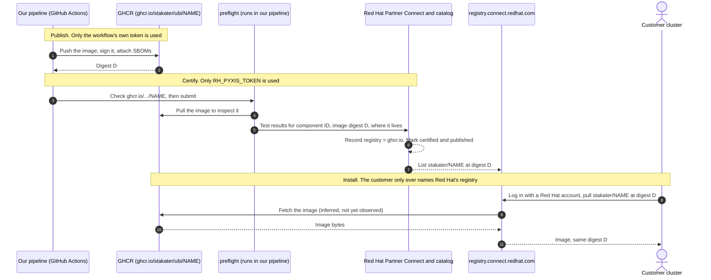
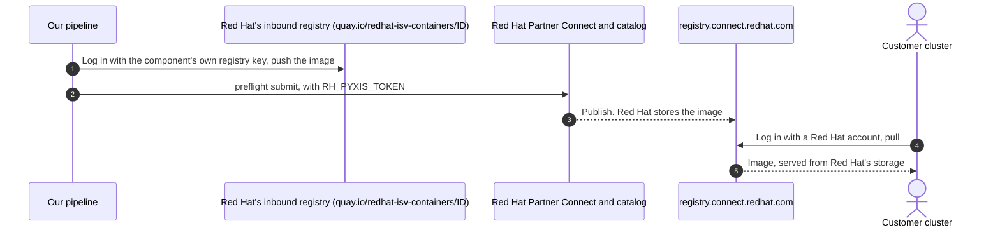

# How an image gets from us to a customer through Red Hat

There are three ways a certified image can be set up in Red Hat Partner
Connect. They differ in two things: **where the image's bytes are stored**, and
**which address a customer pulls from**. Those are separate questions, and
mixing them up is what makes this confusing.

Status key: ✅ observed on 2026-11-27 with the Reloader component ·
⚠️ inferred, not yet proven.

## The three setups

| | Bytes stored on | Customer pulls from | Secrets we hold | Chosen when |
|---|---|---|---|---|
| **A. Red Hat-hosted** | Red Hat's registry | `registry.connect.redhat.com` | API key + one registry key per component | the component is created; cannot be changed later ⚠️ |
| **B. Red Hat distributes, we host** | **our GHCR** | `registry.connect.redhat.com` | API key only | same |
| **C. Our registry is the distribution** | our GHCR | `ghcr.io` | API key only | same |

Reloader's component is **B**. OpenCost's and the MTO components are **A**.

## The short answers

**Does a customer always pull from `registry.connect.redhat.com` in setup B?**
Yes, as far as the catalog is concerned. ✅ Red Hat's catalog lists exactly one
address for the image, `registry.connect.redhat.com/stakater/reloader-operator`,
and has no `ghcr.io` entry for it. ⚠️ Nobody has yet done an authenticated pull
from that address to see it work.

**Is Red Hat then hosting the image on its registry?**
By Red Hat's own record, no. ✅ The component says `hosted_registry = false` and
`registry = ghcr.io`. So the address is Red Hat's, and the storage is ours.
⚠️ The likely mechanism is that `registry.connect.redhat.com` is a front door:
it checks the customer's Red Hat login, then serves the image from GHCR. That
is an inference from three facts, not something we have watched happen:

1. `hosted_registry = false`, `registry = ghcr.io`. ✅
2. The image was listed as published 12 seconds after the submission. ✅ A
   143 MB copy in that time is possible but unlikely; a metadata-only listing
   fits better.
3. The component has a slot for registry credentials that is empty
   (`docker_config_json`). ✅ That slot makes sense only if Red Hat needs to
   pull from a partner's registry.

## Setup B, step by step



What we never do in setup B: log in to Red Hat's registry, push to it, or hold
a registry key for the component.

## For comparison: setup A



The customer's side is identical in A and B. The difference is on our side: A
needs a registry key per component, and Red Hat keeps the bytes.

## What if

These follow from "Red Hat's address, our storage". Each is ⚠️ until tested.

| What if | Setup A | Setup B |
|---|---|---|
| GHCR is down | No effect on customers | Customers probably cannot pull through Red Hat either |
| We delete the tag or the package on GHCR | No effect | The published image probably stops being pullable. **A published tag on GHCR must never be deleted** |
| The GHCR package is made private | No effect | Red Hat can no longer fetch it, unless we give Red Hat a read-only credential (the empty `docker_config_json` slot) |
| The image is private by design (Console, Gateway) | Works | Works only with that credential in place |
| A customer's cluster is air-gapped | They mirror from Red Hat by digest | The same |
| A customer wants to verify our signature | Signatures would have to be on Red Hat's registry | The signature is on GHCR for the same digest, so it can be verified there |
| We want Red Hat to carry the storage risk | Yes | No: GHCR is a production dependency |

## Why this matters for the pipeline

- In setup B, GHCR is not a staging area that happens to feed Red Hat. **It is
  where the published image lives.** Calling the path "staging" and saying
  "nothing we ship references it" is no longer accurate for B images, and
  ADR-002 needs a revision to say so.
- The Red Hat stage for a B component is one step: submit the GHCR image. No
  login, no copy, no second signature.
- A components still need the copy and a registry key.

## How to prove the two ⚠️ points

**1. That the published address pulls** (needs a Red Hat login):

```
podman login registry.connect.redhat.com
podman pull registry.connect.redhat.com/stakater/reloader-operator@sha256:bef05dfdf931d6457cb899d0b64dc0b6ebb9a0ac706c1245ceec8783957c0370
```

**2. Where the bytes come from.** Same login, with debug output; look at which
host the layers are downloaded from:

```
podman --log-level=debug pull registry.connect.redhat.com/stakater/reloader-operator@sha256:bef05dfdf931d6457cb899d0b64dc0b6ebb9a0ac706c1245ceec8783957c0370 2>&1 | grep -iE "redirect|GET https|blob" | head -20
```

A host under `ghcr.io` or `githubusercontent.com` means Red Hat sends the
customer to our storage. A Red Hat or Quay host means Red Hat keeps a copy,
and the "what if" column for B is better than stated above.
